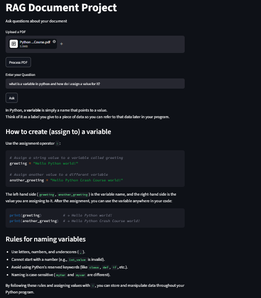

# RAG Document Q&A System

A Retrieval-Augmented Generation (RAG) app. Upload a PDF, ask questions about it, and get answers generated only from the document's content.



## Features
- Upload any PDF document
- Ask natural language questions about the document
- Answers generated by an LLM using only the retrieved context
- Chat history stored in SQLite

## Tech Stack
- **Backend:** FastAPI
- **Frontend:** Streamlit
- **LLM:** Groq (llama-3.1-8b-instant)
- **Embeddings:** HuggingFace `sentence-transformers/all-MiniLM-L6-v2`
- **Vector DB:** ChromaDB
- **Database:** SQLite
- **Framework:** LangChain

## How It Works
1. User uploads a PDF
2. The PDF is split into chunks (size 500, overlap 50)
3. Each chunk is converted into an embedding
4. Embeddings are stored in ChromaDB
5. For a question, the top 2 most similar chunks are retrieved
6. The chunks and the question are sent to the LLM (Groq)
7. The answer is returned and saved in SQLite

## Setup

1. Clone the repository
```
git clone https://github.com/YOUR_USERNAME/rag-project.git
cd rag-project
```
2. Create and activate a virtual environment
```
python -m venv venv
venv\Scripts\activate
```
3. Install dependencies
```
pip install -r requirements.txt
```
4. Create a `.env` file with your Groq API key
```
GROQ_API_KEY=your_key_here
```
5. Create the database (run once)
```
python setup_db.py
```
6. Start the backend
```
uvicorn api:app --reload
```
7. In a new terminal (activate venv again), start the frontend
```
streamlit run app_ui.py
```

## Future Improvements
- Support more formats (Word, TXT)
- Multi-document querying
- Show source page numbers with answers
- Better prompt engineering for more accurate responses